# Building a Production Grade Agentic AI Blueprint (BFSI)
> Enabling a Agentic Banking application from demo to production at scale

1. [Context](#context)
2. [Problem Statement](#problem-statement)
3. [Agentic AI Blueprint](#full-scale-agentic-ai-blueprint)
4. [Step 1: Demo and Proof-of-Concept](#step-1-demo-and-proof-of-concept)
5. [Step 2: Enabling Agent access to the Bank's API ](#step-2-enabling-the-agent-access-to-the-banks-internal-data-through-apis)
6. [Step 3: Introduce Domain-specific Agents](#step-3-create-domain-specific-sub-agents-and-assign-only-those-tools-it-needs-access-to)
7. [Step 4: An Agent Supervisor or Orchestrator](#step-4-who-decides-which-agent-answers)
8. [Step 5: Expose Tool via MCP Servers](#step-5-expose-tools-via-mcp-servers-to-create-a-loosely-coupled-design)
9. [Step 6: Adding Authentication and short-lived credentials](#step-6-authentication)
10. [Step 7: Adding Authorization](#step-7-authorization)
11. [Step 8: Hybrid LLMs setup for different tasks](#step-8-split-llm-into-self-hosted-and-open-weight)
12. [Step 9: Memory and State Management](#step-9-memory-and-state-management)
13. [Step 10: Addressing data residency requirements](#step-10-pii-never-leaves-the-bank)
14. [Step 11: Agent Evaluation Suite](#step-11-agent-evaluation-suite)
15. [Step 12: Monitoring and Observability](#step-12-agentops-and-llmops-monitoring--observability)
16. [Step 13: Adding a Cost Tracker](#step-13-finops-cost-management)
17. [Step 14: Edge Layer Security](#step-14-defense-in-depth-edge-layer-security)

## Context
A bank's customer service lead has reported that 300,000 calls were made last month

75% of them asked three questions:
* What's is my balance?
* What was this debit from my account?
* Send me cheque book

## Problem Statement
* Average call handling time, four minutes
* Every year bank pays millions of dollars to the network provider

But the bank's mobile and web app already has all of this. Why are they still calling?

Because the app has multiple screens and some of the customers don't know how to navigate these screens to find out what they need. So they will find it easier to ask their questions to a customer support person over a call. 

## Business Opportunity and Solution
* Having an AI-native application that can securely perform banking transactions to automate simple queries such as checking of bank balance and updating of particulars
* Evolution of agentic payments where bank transfers can be made almost autonomous with high-value transactions requiring human-in-the-loop approvals
* Enabling banking workforce to focus on providing value on other areas such as customer relationship management and building trust with high net worth clients  

## Full Scale Agentic AI Blueprint

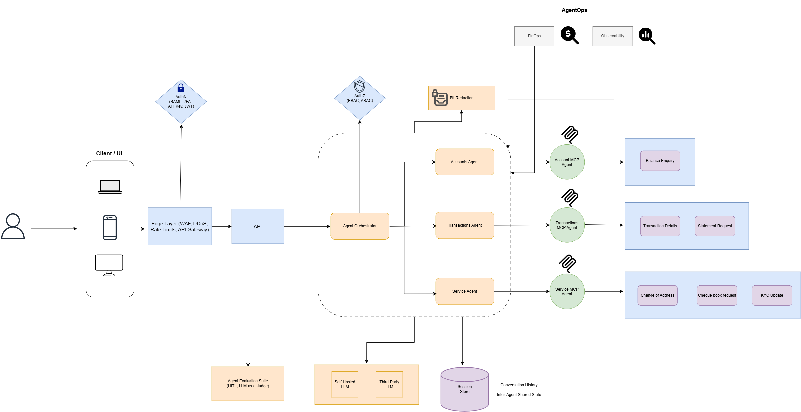

#### Step 1: Demo and Proof-of-Concept

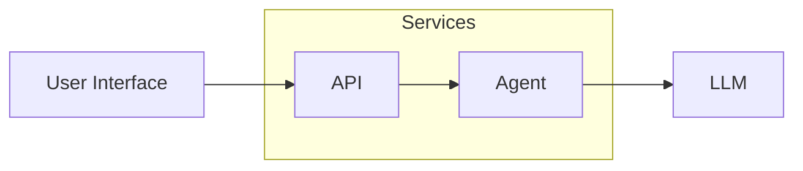

#### Step 2: Enabling the agent access to the bank's internal data through APIs

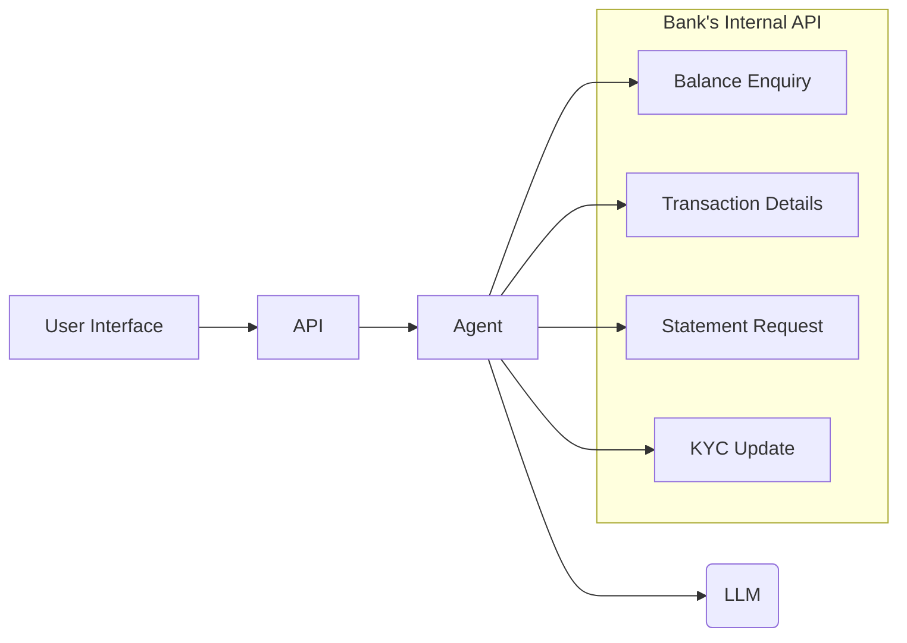

#### Step 3: Create domain specific sub agents and assign only those tools it needs access to 

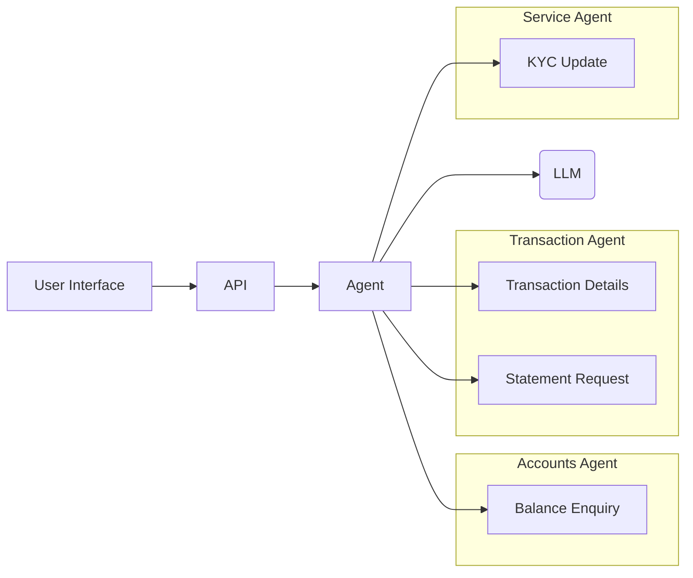
* Accounts Agent - Check the balance of a customer CASA (Current or Savings Account)
* Transactions Agent - Check the latest transactions of a customer e.g Date of Salary Credited
* Service Agent - Update a customers's particulars e.g. change of address or contact number

#### Step 4: Who decides which agent answers?
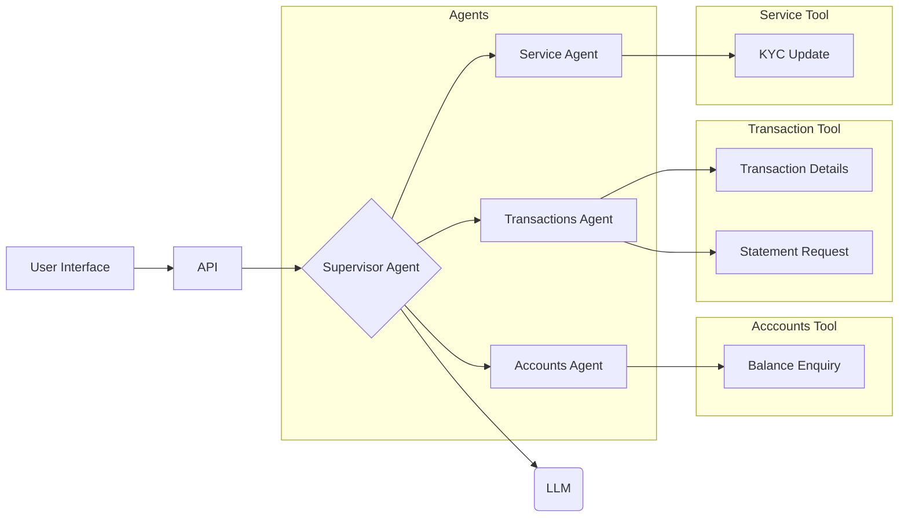

#### Step 5: Expose tools via MCP servers to create a loosely coupled design

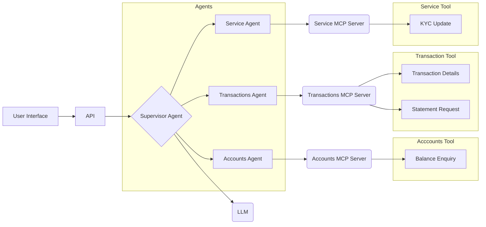
* MCPs decouple agents from tools by routing capabilities through dedicated modular servers

#### Step 6: Authentication
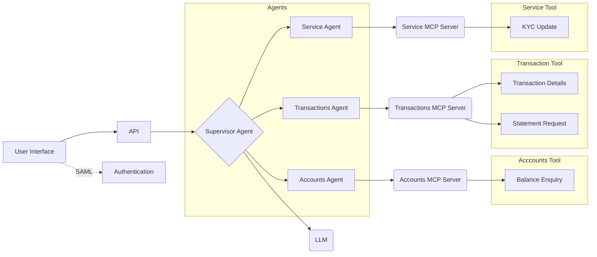

#### Step 7: Authorization

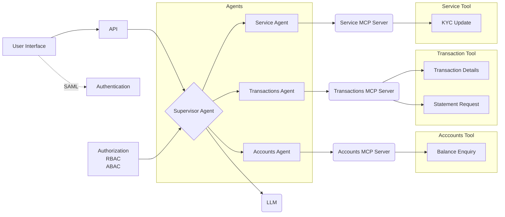

#### Step 8: Split LLM into Self-Hosted and Open Weight
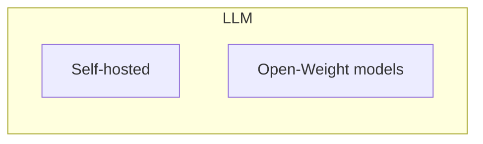
#### Step 9: Memory and State Management
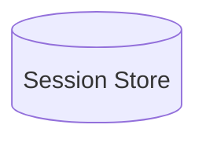

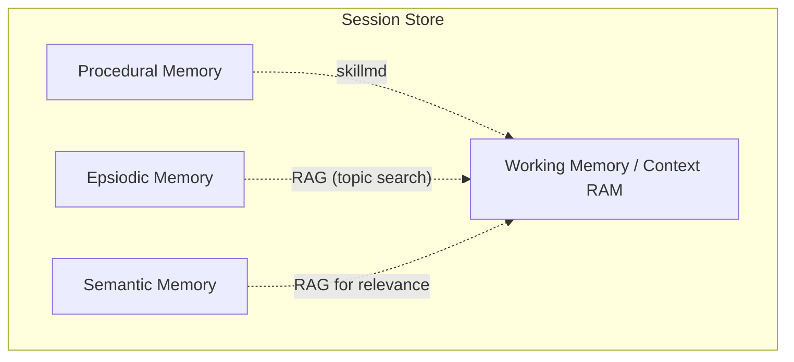
##### Types of Memory
* Working Memory: Current session memory
* Episodic Memory: Dated events and past chat history
* Semantic Memory: Durable facts and user profile
* Procedural Memory: Instructions and Skills

#### Step 10: PII Never Leaves the Bank
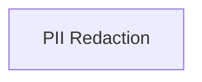
#### Step 11: Agent Evaluation Suite
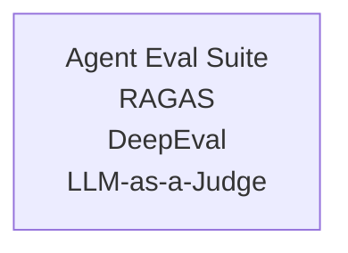

#### Step 12: AgentOps and LLMOps (Monitoring & Observability)
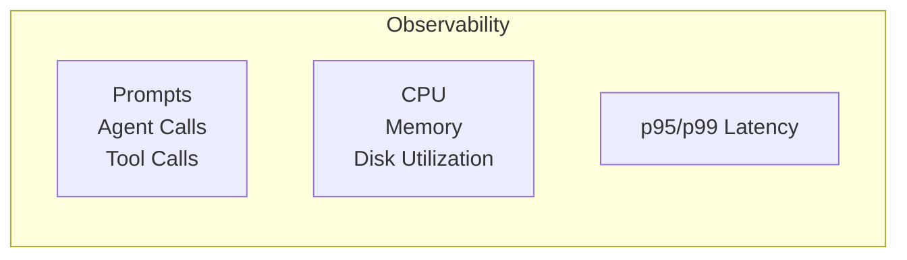
#### Step 13: FinOps (Cost Management)
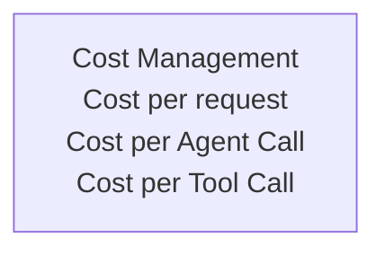
#### Step 14: Defense in Depth (Edge Layer Security)
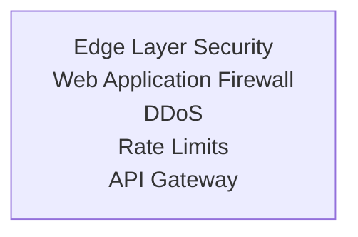