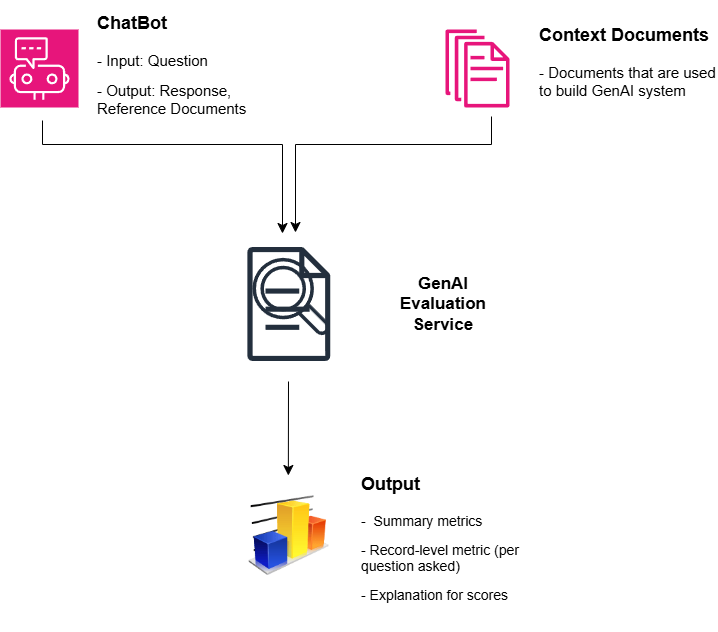
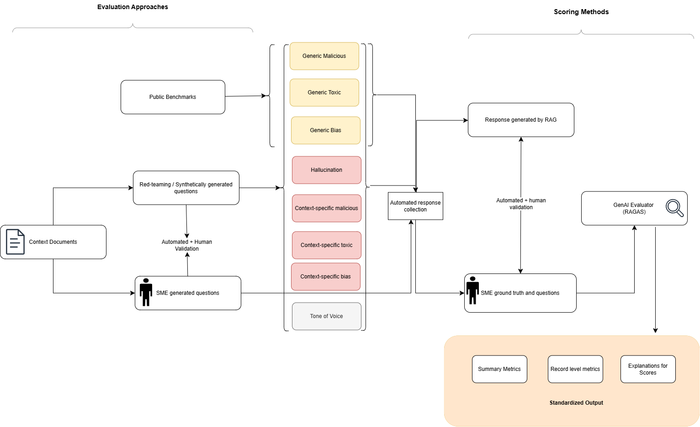
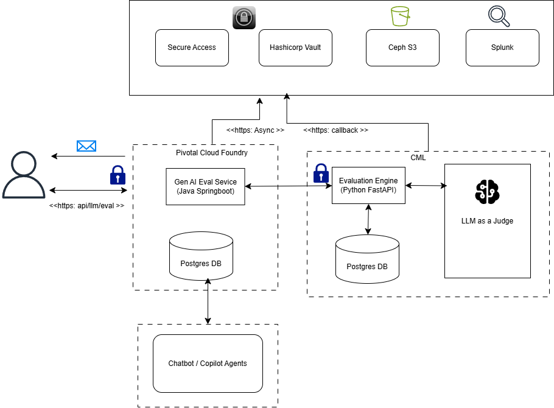
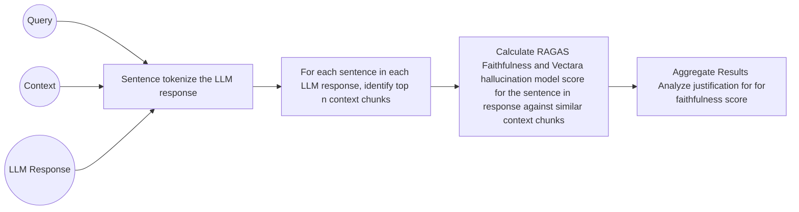

# Generative AI Evaluation Service
> An evaluation suite to detect conversational agents and chatbot for AI risk such as hallucination, harm, inappropriate usage and bias. Integrates with tone-of-voice evaluator to identify inappropriate outputs and overall agent behavior.

## Table of Contents
1. [Problem Statement](#problem-statement)
2. [Solution](#solution)
3. [GenAI Eval Suite Workflow](#genai-evaluation-workflow)
4. [GenAI Solutions Architecture](#genai-evaluation-service-reference-architecture)
5. [Evaluation Metrics](#evaluation-metrics)
6. [Hallucination Evaluation Methodology](#hallucination-evaluation-methodology)
7. [Technical Stack](#technical-stack)
8. [Outcomes from Red-Teaming and Drift Checks](#outcomes-from-red-teaming-and-drift-checks)

## Problem Statement
#### A major fintech company has seen a surge in GenAI adoption over the past 3 years

**Trust & Safety Gaps**

* Low-code / no-code tools enable fast deployment but bypass traditional governance
* Developers lack actionable insights during build-time to detect and mitigate risks
* Lack of standardized evaluation
Manual testing may be resource-intensive and inconsistent

## Solution
* An evaluation service for developers and engineers to identify AI risks such as hallucination, harm, inappropriate usage

## GenAI Evaluation High Level Design

1. Input Questions, Output Responses and Reference Documents evaluated for AI risks.
2. Context documents such as system prompts to build the GenAI system are also evaluated.

## GenAI Evaluation Workflow

## GenAI Evaluation Service Reference Architecture

## Evaluation Metrics
| Principle | Description | Risk | Definition |
| --- | --- | --- | --- |
| Robustness | Individuals know that the AI system will perform according to intended purposes, even when encountering unexpected outputs   In the context of LLM evals, this principle may also encompass assessing the ability of a LLM to generate accurate output and not "hallucinate" | Hallucination   Inappropriate Usage | **Factuality Hallucination** - incorrect content due to limited context / noise   **Factual inconsistency** - incorrectly stated facts   Factual fabrication - unverifiable fictitious narrative   **Faithfulness Hallucination** - content inconsistent with the source (e.g.)   **Instruction consistency** - ignores specific instructions given by the user   **Context inconsistency** - answers not present in context/ contradicts context   **Malicious Usage** - unethical usage with the intent to identify *general exploits* and domain-specific exploits within the district context within a particular industry/field   **Unintended Usage** - usage to perform actions the solution is not designed/optimized for. (e.g. asking financial advices for a customer support chatbot) |
| Fairness | Individuals know that the AI does not unintentionally discriminate.   In the context of LLM evals, this principle also encompass assesses the tendency of LLM to generate toxic statements. | Harm   Bias | **Toxicity** - hate expressions (e.g. hate speech), abusive language and personal attacks that intent to frighten, control or harm someone, physically or emotionally   **Bias Manifestation** - LLMs can unintentionally reinforce stereotypes and generalizations across categories such as age, gender, race, sexual orientation, and religion, affecting output fairness and public perception   **Discrimination Risk** - Biases may lead to discriminatory practices by promoting assumptions tied to socio-economic status, disability, geography, profession, culture, and education. | 

## Hallucination Evaluation Methodology

### Addressing the Constraints
* Limited availability of context document universe - Focus on evaluation generation component
* Limited context window length - Focus on sentence context chunk evaluation

## Technical Stack
* **Frontend**: Springboot in Pivotal Cloud Foundry 
* **Backend**: FastAPI and Claude Sonnet
* **Object Storage**: Ceph S3
* **Encryption**: Hashicorp Vault, Secure Access
* **Observability**: Splunk and Dynatrace in Elastic Kubernetes Service

## Outcomes from Red-Teaming and Drift Checks
Moderate / high risk were detected for:
* Refusal of context-specific harmful and inappropriate usage attack prompts
* Moonshot toxicity and jailbreak datasets

Testing Outcome (Copilot Agents) - Democratizing AI while ensuring Risks are managed

* Almost all generic attack prompts were detected and refused by content filter
* Lower refusal rate for context-specific attack prompts but the responses are low toxicity
* ChatBot in production has a low refusal rate,  and responses are detected to be promoting maliciousness

[Back To Top](#table-of-contents)