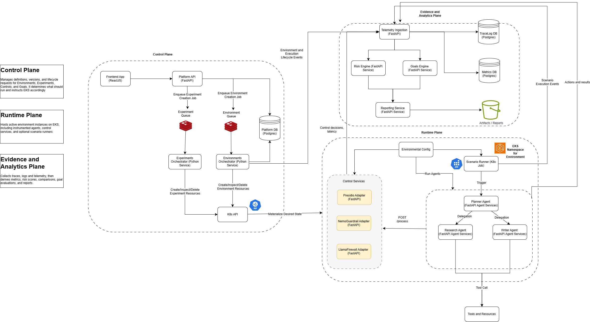
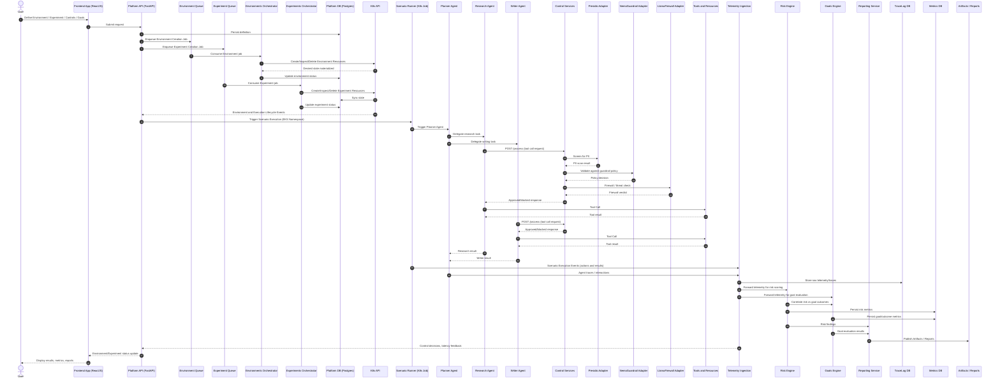

# AI Observability Platform
> Building an observable, quantifiable and actionable risks and controls in multi-agent systems

## Problem Statement
* No systematic approach to understanding cost, performance and effectiveness of controls
* Existing evaluations are only scoped to individual agents
* Performance and cost impact of controls requires effort to measure

## Negative Impacts
* Unjustified investments in control products
* Control requirements may be overstated or understated
* Increased effort in performing basic analysis or research

## Context Digram

## Sequence Diagram

