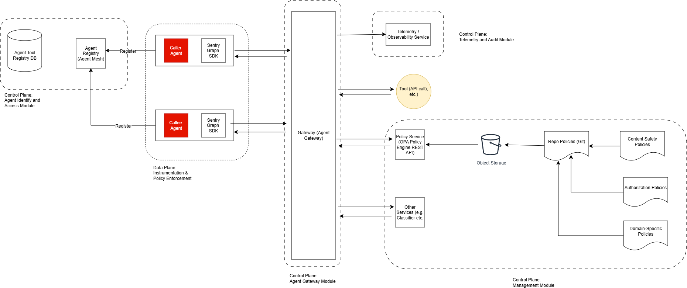

# Building a Policy Driven Governance for Agentic Systems

## High Level Digram

## Policy-as-Code
> Machine executable rules that determine what an agent is permitted to do before it acts - enforced automatically, not documented in a PDF

* A set of rules that governs all aspects of security-relevant system and system component behaviour 
* NIST AI Agent Standard Initiative uses policy to mean runtime authorization controls - least privilege, task-scope access, and action-level approval for autonomous agents
* Agent policies define autonomy levels, role-based permission management and least privilege boundaries

## E2E Risk Coverage for Agentic Systems
1. Output-level evaluation - Enables standardized, low-friction evaluation across systems
	* Works across models and vendors
	* Requires minimal system integration
	* Easy to scale across many use cases
2. System-level evaluation - Required to assess risks in multi-step and agentic systems
	* Captures multi-step risks
	* Evaluates decision chains and tool interactions
	* Identifies failure modes not visible in outputs 
3. Runtime Governance (Sentry Graph) - Enforces real-time, context-aware control over agent actions in production
	* Intercepts and evaluate actions before execution
	* Applies policy decision based on context and intent
    * Provides full auditability of decisions and system behaviour 

## Agent Identities and Onboarding

* Agent generates a verifiable identity  during onboarding
* A DID is a globally unique ID derived from an agent's keypair, used to verify that a message or action genuinely came from that agent
* Agent are tied to sponsors
* During registration, user provides details including user id, email and workplace id
* These details are retrieved by the SDK during the bootstrapping
* SDK plays important role in boot strapping the agent to the platform as 'Managed Agent'

## Intent Based Policy Enforcement
* Delegation intent
	* Inbound. An agent attempts to receive a delegation task from another agent
	* Outbound. An agent is attempting to delegate to another agent
* Tool call intent
	* An agent is attempting to call a tool via internal function or MCP call
* Output intent
	* An agent is attempting to output data or respond to requests

## Industry Alignment 
* Cover OWASP Top 10 for agentic systems
* Comes supported by the agent governance toolkit